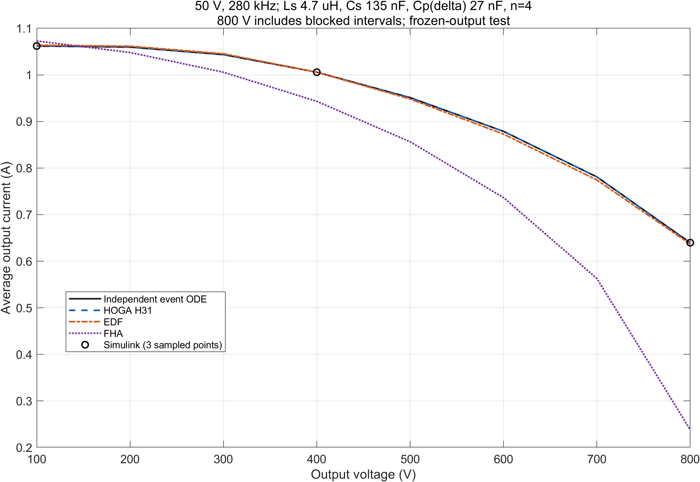
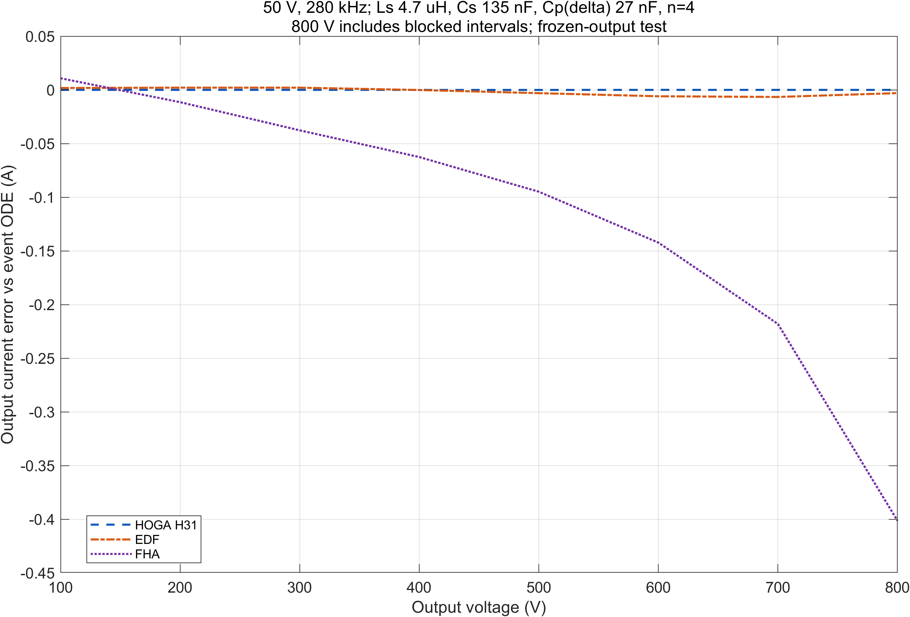
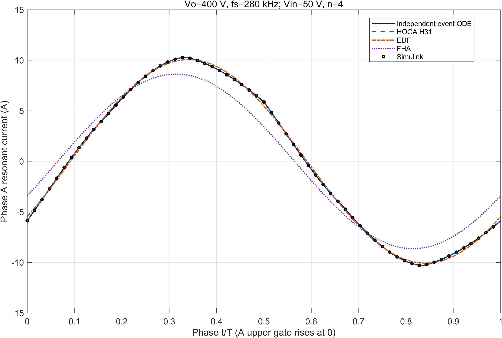
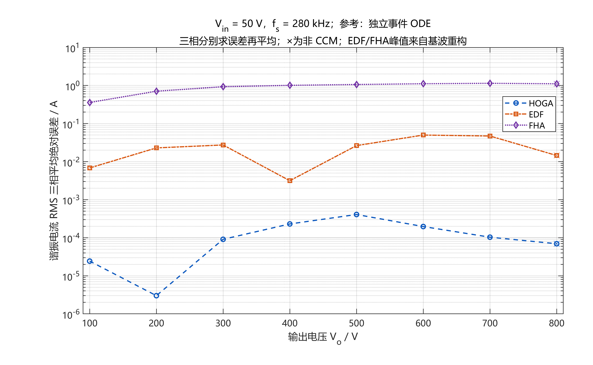
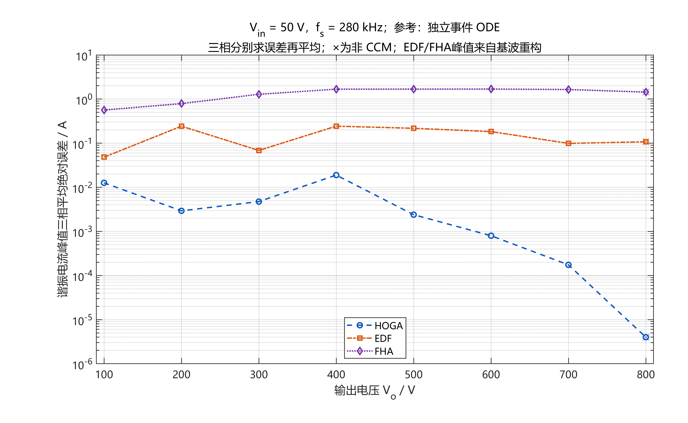
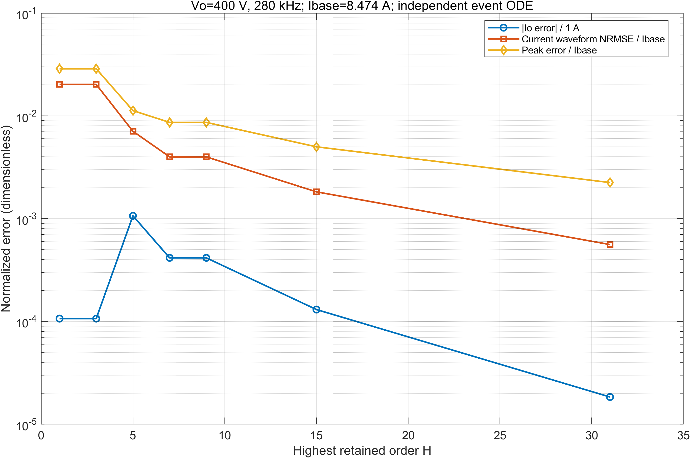
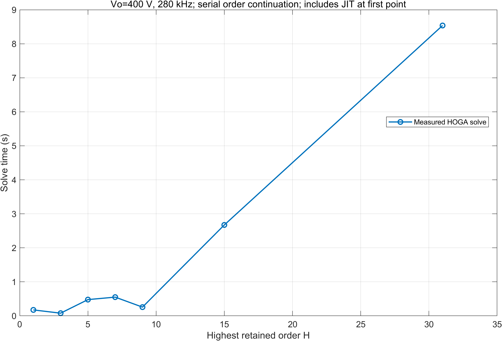

# 04 模型对比：HOGA / EDF / FHA / Simulink

> 数据：`data/comparison/`；完整报告：`reports/comparison/HOGA_EDF_FHA_Accuracy_Analysis.md`。
> 这一组结果回答的是：在**同一 50 V Δ/Y 三相 LCC、同一参数、冻结输出电压**下，HOGA（H31）相对 EDF、FHA 的稳态端口精度如何。

## 4.1 比较平台

| 项 | 设置 |
|---|---|
| 电路 | 50 V 输入、三相 Δ/Y LCC、共用六二极管桥、Co 等效 3.125 μF |
| 参数 | Ls 4.7 μH、Cs 135 nF、Cp 27 nF/Δ边、n=4、Rin 1 mΩ、Vf 0.6 V |
| 输出 | **冻结** `Vo`（两个 `Vo/2` 电压源替代 Co），不是真实充电 |
| 工况 | 280 kHz 下 100–800 V（8 点）+ 100/400/800 V 下 240/260/280/300/320 kHz（去重后共 20 点） |
| 主参考 | 独立事件 ODE（六面 KKT + 周期射击），`RelTol=1e-10`、`AbsTol=1e-11` |
| Simulink | 仅 100/400/800 V、280 kHz 三点；coarse/fine 两档 |
| 模型 | HOGA H31、EDF（基波 + 描述函数）、FHA（基波 + 六阶梯钳位） |
| 记录 | 20 点 × 4 方法 = 80 条有效结果 |

CCM 判定：整流桥不存在有限时长全截止区间。20 点中 16 点为共同 CCM，4 点非 CCM（800 V/240、260、280、320 kHz）；其中 240/260 kHz 为全截止周期代表解（`Io=0`），单列不参与主统计。

## 4.2 主结果（16 个共同 CCM 点）

| 指标 | HOGA H31 | EDF | FHA |
|---|---:|---:|---:|
| 平均输出电流绝对误差 `Io MAE` | **15.579 μA** | 4.284 mA | 90.874 mA |
| 最大输出电流绝对误差 | **72.043 μA** | 24.321 mA | 480.332 mA |
| `Io` NRMSE（基值 1 A） | **2.6773e-5** | 7.1455e-3 | 0.15000 |
| 三相 RMS 平均绝对误差 | **0.159 mA** | 32.659 mA | 0.924 A |
| 三相峰值平均绝对误差 | **4.838 mA** | 124.619 mA | 1.367 A |
| 合并波形 NRMSE（基值 8.47399 A） | **0.05664%** | 1.90564% | 22.20782% |
| 400 V/280 kHz 暖启动时间 | 10.876 s | 0.0549 s | 0.000942 s |

说明：

- 时间不是纯算法复杂度比较：HOGA 为 H31 + H7 种子，EDF/FHA 是代数根，输入辅助信息不同；严格冷启动没有匹配测量。
- HOGA 的 `Io` 误差已经接近参考自身的数值平台差（约 15 μA / 0.2 mA），所以“0.004%”应理解为“与参考在数值平台内一致”，不是物理精度。
- EDF 相对 FHA 的 `Io MAE` 减少约 95.29%；HOGA 相对 EDF 减少约 99.64%。改善幅度大，但是否值得取决于设计容差与计算预算。

## 4.3 全 20 点（含非 CCM）

| 指标 | HOGA | EDF | FHA |
|---|---:|---:|---:|
| `Io MAE` | **13.012 μA** | 3.606 mA | 94.229 mA |
| `Io` 最大绝对误差 | **72.043 μA** | 24.321 mA | 480.332 mA |
| RMS MAE | **0.134 mA** | 27.800 mA | 0.820 A |
| 峰值 MAE | **5.043 mA** | 130.282 mA | 1.228 A |
| 波形 NRMSE | **0.05698%** | 1.83720% | 25.33088% |

4 个非 CCM 点单列：

| 指标 | HOGA | EDF | FHA |
|---|---:|---:|---:|
| `Io MAE` | **2.743 μA** | 0.891 mA | 107.649 mA |
| RMS MAE | **0.0317 mA** | 8.364 mA | 0.405 A |
| 峰值 MAE | **5.863 mA** | 152.933 mA | 0.669 A |
| 波形 NRMSE | **0.05834%** | 1.53318% | 35.14995% |

## 4.4 电压扫描（280 kHz）

| `Vo`/V | ODE `Io`/A | HOGA/A | EDF/A | FHA/A | HOGA 误差/μA | EDF 误差/mA | FHA 误差/mA |
|---:|---:|---:|---:|---:|---:|---:|---:|
| 100 | 1.06198359 | 1.06198317 | 1.06376044 | 1.07281523 | −0.414 | 1.777 | 10.832 |
| 200 | 1.05953196 | 1.05953170 | 1.06159739 | 1.04807536 | −0.261 | 2.065 | −11.457 |
| 300 | 1.04335616 | 1.04335026 | 1.04542738 | 1.00566476 | −5.905 | 2.071 | −37.691 |
| 400 | 1.00576998 | 1.00575159 | 1.00566342 | 0.94320590 | −18.392 | −0.107 | −62.564 |
| 500 | 0.95121742 | 0.95118006 | 0.94815051 | 0.85632757 | −37.365 | −3.067 | −94.890 |
| 600 | 0.87873631 | 0.87875664 | 0.87278423 | 0.73644546 | +20.334 | −5.952 | −142.291 |
| 700 | 0.78096864 | 0.78098142 | 0.77437487 | 0.56287236 | +12.777 | −6.594 | −218.096 |
| 800* | 0.63975722 | 0.63976810 | 0.63676077 | 0.23833819 | +10.884 | −2.996 | −401.419 |

`*` 800 V 为非 CCM。

要点：

- ODE 输出电流从 100 V 的 1.061984 A 降到 800 V 的 0.639757 A，下降约 39.76%。
- FHA 的误差从 200 V 到 800 V 持续增大；800 V 约 −62.75%，不能用“基波足够准”概括。
- EDF 在 400 V 的输出电流误差只有约 −0.0106%，但同点峰值误差约 0.244 A；平均量准不代表波形/应力准。
- HOGA 最大输出误差出现在 500 V（37.365 μA），不在最高压。

## 4.5 波形、RMS 与峰值

典型 100/400/800 V、280 kHz：

| `Vo`/V | 模型 | 三相最大 RMS/A | 三相最大峰值/A | RMS MAE/A | 峰值 MAE/A | 波形 NRMSE/% |
|---:|---|---:|---:|---:|---:|---:|
| 100 | ODE | 5.941107 | 8.459929 | — | — | — |
| 100 | HOGA | 5.941132 | 8.472541 | 0.0000243 | 0.012612 | 0.05610 |
| 100 | EDF | 5.947925 | 8.411636 | 0.006817 | 0.048294 | 1.44669 |
| 100 | FHA | 5.582950 | 7.895484 | 0.358157 | 0.564445 | 4.66046 |
| 400 | ODE | 7.111843 | 10.305781 | — | — | — |
| 400 | HOGA | 7.111612 | 10.286756 | 0.000230 | 0.018949 | 0.05598 |
| 400 | EDF | 7.114994 | 10.062122 | 0.003152 | 0.243583 | 2.02337 |
| 400 | FHA | 6.100296 | 8.627121 | 1.011547 | 1.678584 | 17.64519 |
| 800* | ODE | 8.628231 | 12.074062 | — | — | — |
| 800* | HOGA | 8.628301 | 12.074066 | 0.0000695 | 0.00000399 | 0.05617 |
| 800* | EDF | 8.613751 | 12.181684 | 0.014480 | 0.107622 | 1.28266 |
| 800* | FHA | 7.518459 | 10.632707 | 1.109772 | 1.441355 | 65.56523 |

注意：

- 前两列是“相间最大”的应力，误差列是“逐相比较后平均”；两者不要求相减等于 MAE。
- EDF/FHA 的峰值是正弦重构预测，不包含寄生振铃、反恢复或器件电容尖峰。
- 800 V 的 FHA 波形 NRMSE 达 65.565%，主要不是“谐波变多”，而是整流端口等效导致的幅值/相位/传能偏差。

## 4.6 逐点反例（不能被总体平均掩盖）

1. **100 V/260 kHz 峰值**：HOGA 峰值 MAE 9.661 mA，EDF 4.562 mA —— EDF 在该点峰值更准。同点 RMS MAE 仍是 HOGA 31.54 μA、EDF 12.216 mA；波形 NRMSE 0.06066% vs 1.63833%。
2. **400 V/300 kHz 输出电流**：FHA 误差 +0.182 mA，小于 EDF 的 +1.609 mA；但 FHA 同点 RMS 误差 0.614901 A，远大于 EDF 的 0.026159 A。单看平均输出会误判。
3. **升阶非单调**：100 V 的 H7→H15 峰值最大误差从 12.462 mA 增到 16.755 mA，H31 仍为 12.612 mA；波形 NRMSE 却从 0.36310% 降到 0.05610%。峰值与整体波形是不同目标。
4. **H1≈H3、H7≈H9**：平衡、半波对称、零序约束使部分三倍频电流谐波消失；形式阶数增加不等于新增有效分量。

## 4.7 阶数收敛

| H | 本地守卫通过 | 最大输出绝对误差/mA | 最大相 RMS 误差/mA | 最大相峰值误差/mA | 实测求解时间范围/s |
|---:|---:|---:|---:|---:|---:|
| 1 | 4/4 | 6.5938 | 47.1193 | 243.6593 | 0.134–1.759 |
| 3 | 4/4 | 6.5938 | 47.1193 | 243.6593 | 0.078–0.185 |
| 5 | 4/4 | 1.8363 | 14.6115 | 95.3635 | 0.478–3.008 |
| 7 | 4/4 | 0.41545 | 4.95143 | 73.2591 | 0.550–3.804 |
| 9 | 4/4 | 0.41545 | 4.95143 | 73.2591 | 0.256–1.355 |
| 15 | 4/4 | 0.18021 | 1.50791 | 42.3861 | 2.673–7.529 |
| 31 | 4/4 | 0.01839 | 0.23026 | 19.0254 | 8.537–28.527 |

四个 H31 严格验收点（100/400/700/800 V、280 kHz）的参考精化与验收：

| `Vo`/V | 参考 `Io` 相对变化 | 参考峰值相对变化 | 事件时间变化/`T` | H31 严格验收 |
|---:|---:|---:|---:|---|
| 100 | 3.56e-11 | 1.50e-8 | 9.38e-12 | PASS |
| 400 | 3.66e-11 | 1.70e-5 | 1.17e-11 | PASS |
| 700 | 1.42e-10 | 6.47e-8 | 1.82e-11 | PASS |
| 800* | 4.05e-10 | 5.44e-8 | 6.90e-11 | PASS（非 CCM） |

其余 16 点没有做同等级的“两次升阶 + 独立参考”严格验收；不能把 20 点都说成“严格验收通过”。

## 4.8 三点 Simulink 交叉验证

| `Vo`/V | ODE `Io`/A | Simulink fine `Io`/A | fine−ODE/μA | fine−coarse/μA | 相邻周期相对差 |
|---:|---:|---:|---:|---:|---:|
| 100 | 1.061983587 | 1.061976523 | −7.064 | 15.817 | 1.1885e-5 |
| 400 | 1.005769979 | 1.005751832 | −18.147 | 13.158 | 1.2520e-5 |
| 800 | 0.639757219 | 0.639743589 | −13.630 | 12.753 | 2.9772e-5 |

三点最大相对电流差约 0.002131%。约 13–16 μA 的 fine/coarse 变化意味着：小于这个量级的差异不宜解释为模型优劣。

注意：Simulink 只跑了 3 个点；另外 17 点的参考是独立事件 ODE，不是 Simulink。不能写成“20 点 Simulink 扫描”。

## 4.9 结论与边界

在本电路、本参数、这 20 点内：

1. 事件增强 HOGA 的 `Io`、RMS、峰值、波形误差整体小于本工程的 EDF/FHA 实现。
2. 这个优势来自“多谐波电流 + 整流事件一致闭合”，不是“只要阶数高就准”。
3. EDF 在多数平均输出指标上优于 FHA，但仍丢失电流高次谐波；FHA 在高压/低频段偏差明显，不能用于高精度充电特性替代。
4. 不能推广为“所有三相 LCC、所有 EDF/FHA 实现、任意参数”的普遍排名。
5. 这是**冻结周期稳态**比较，不是连续充电、关断过冲、损耗温升或硬件验证。

## 4.10 来源

- `reports/comparison/HOGA_EDF_FHA_Accuracy_Analysis.md` 第 3–6 章
- `reports/comparison/Model_Comparison_Report.md`
- `data/comparison/error_statistics.csv`
- `data/comparison/point_results.csv`
- `data/comparison/port_metrics.csv`
- `data/comparison/harmonic_convergence.csv`
- `data/comparison/convergence_validation.csv`
