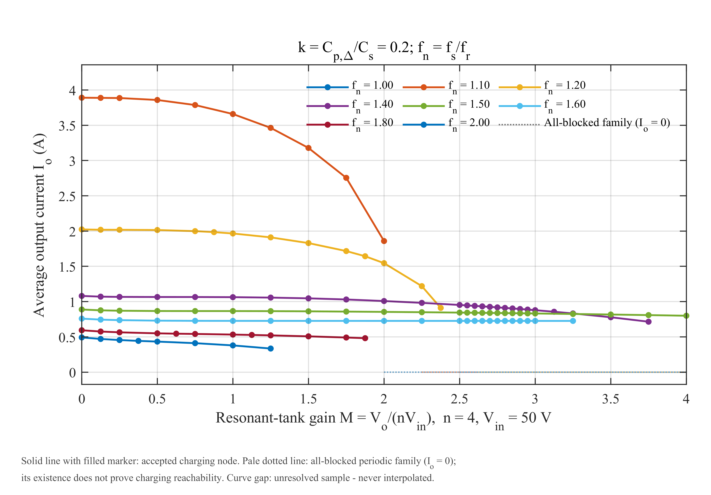
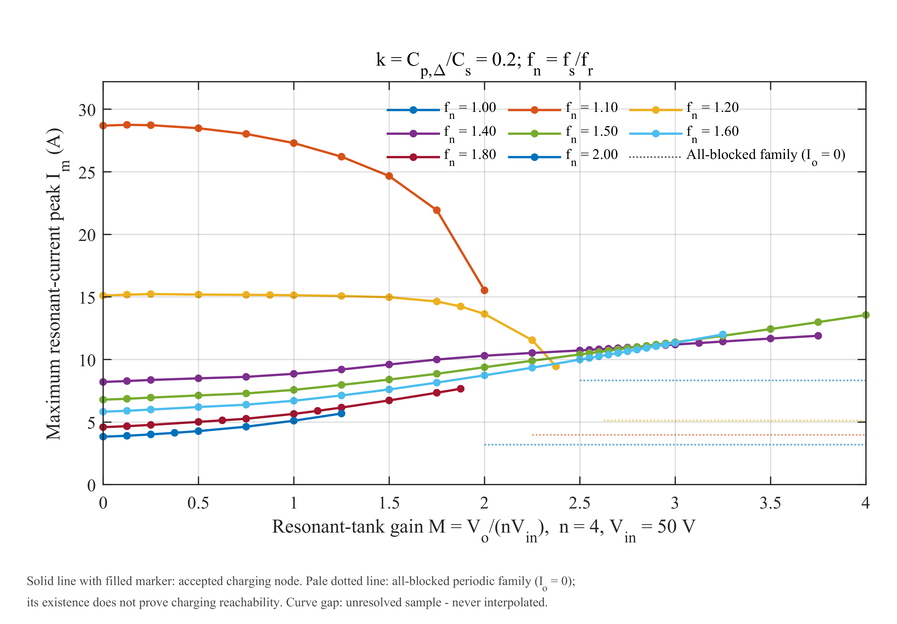
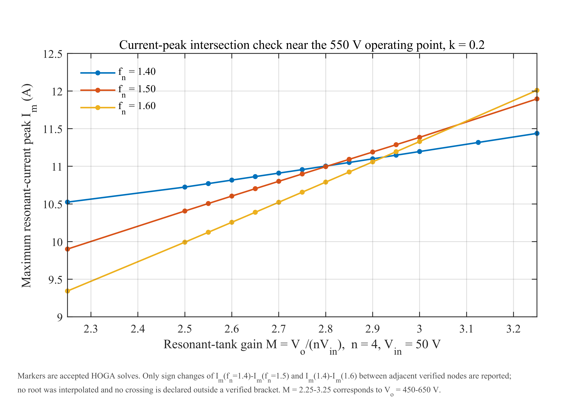
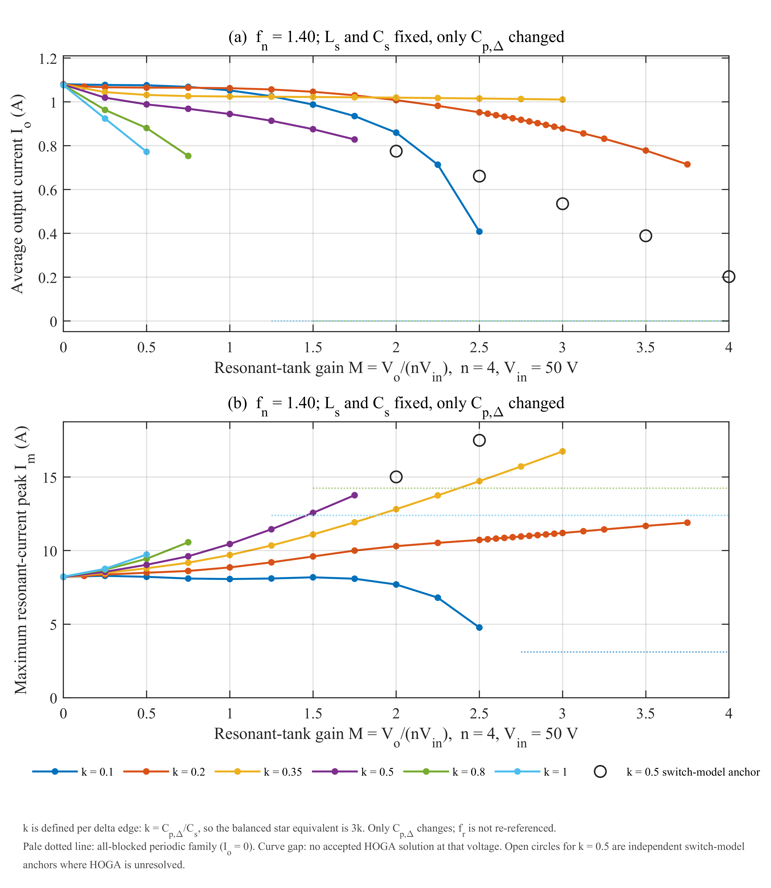
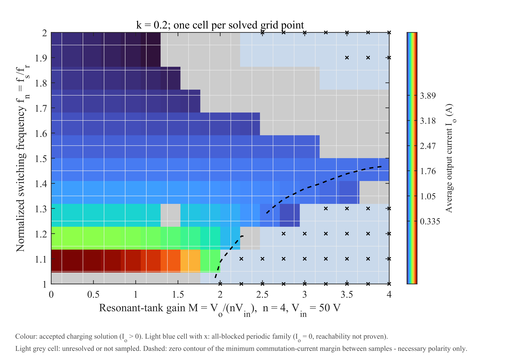
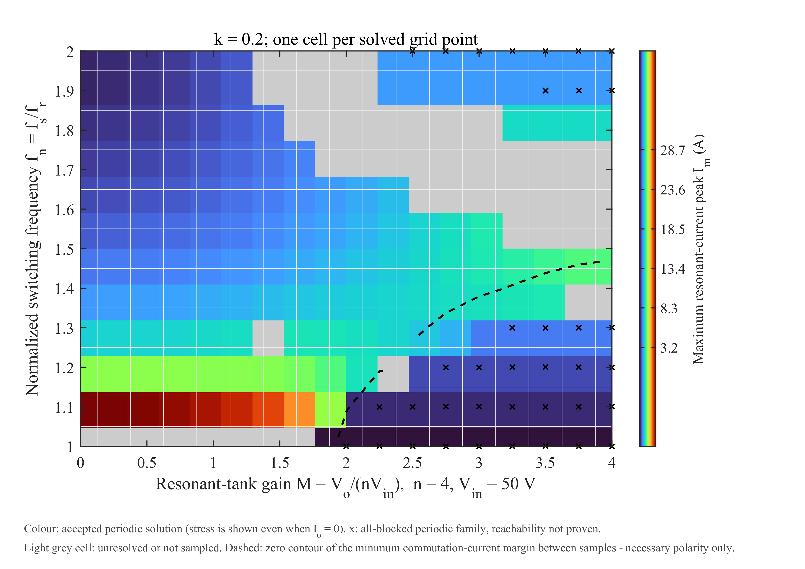

# 05 归一化特性扫描：344 个工况点的 HOGA 地图

> 数据：`data/normalized/characteristic_domain.csv`；完整报告：`reports/normalized/02_扫描与求解状态.md`、`05_结果与讨论.md`。
> 这一组结果回答的是：把开关频率和并联电容比做成无量纲变量后，三相 LCC 在 50–800 V 内的**输出能力、电流应力和可行域**是什么样。

## 5.1 归一化定义

| 量 | 定义 | 值 / 范围 |
|---|---|---|
| 谐振频率 | `fr = 1/(2π√(LsCs))` | 199.804064 kHz |
| 阻抗基值 | `Z0 = √(Ls/Cs)` | 5.900408 Ω |
| 归一化频率 | `fn = fs/fr` | 1.0–2.0（约 199.8–399.6 kHz） |
| 电容比 | `k = Cp_delta/Cs` | 0.1 / 0.2 / 0.35 / 0.5 / 0.8 / 1.0 |
| 谐振腔增益 | `M = Vo/(nVin)` | 0–4；`M=4` 对应 800 V |
| 输出电流归一 | `Jo = Io/(Vin/Z0)` | 无量纲 |
| 应力归一 | `Jm = Im/(Vin/Z0)` | 无量纲 |

`k` 改变的是 Δ 每条边的 `Cp_delta`：

| `k` | 0.1 | 0.2 | 0.35 | 0.5 | 0.8 | 1.0 |
|---|---:|---:|---:|---:|---:|---:|
| `Cp_delta`/nF | 13.5 | 27 | 47.25 | 67.5 | 108 | 135 |

注意：

- `k_star = 3k` 只用于平衡星等效推导；主数据始终使用实际 Δ 参数。
- 改变 `k` **不重新定义** `fr`，只改变每条边的 `Cp_delta`。
- 曲线不是“无损、任意器件”的通用图：`Rin/Z0 ≈ 1.6948e-4`、`Vf/Vin = 0.012` 与具体参考电路绑定。

## 5.2 扫描设计与实际状态

| 阶段 | 计划点 | 现存原始 MAT | 通过 | 其中充电 | 其中全阻断族 | 未决 |
|---|---:|---:|---:|---:|---:|---:|
| A：`Vo=0:50:800` × `fn=1:0.1:2`，另 `fn=1.4` 六个 `k` | 272 | 259 | 176 | 115 | 61 | 96（首次运行状态） |
| B：自适应 168 点 | 168 | 168 | 87 | 75 | 12 | 81 |
| C：恢复扫描（B 后 81 个未决点） | 81 | 81 | 13 | 13 | 0 | 68 |
| **并集（唯一点）** | **440** | **508 条记录 / 344 唯一点** | **276** | **203** | **73** | **68** |

最终状态（以 `characteristic_domain.csv` 为准）：

- **344 个唯一点**；
- **276 个通过** = **203 个充电 CCM** + **73 个全阻断周期族**；
- **68 个未决**；
- 通过点中 **H31 共 257 点、H63 共 19 点**；
- 203 个充电点全部为 CCM（`blocked_fraction < 1e-8`），本轮没有 DCM 充电点。

> **口径提醒**：`reports/normalized/05_结果与讨论.md` 与 `06_交付清单.md` 里仍保留阶段 C 之前的“263 通过 / 190 充电 / 81 未决”口径；`02_扫描与求解状态.md` 第 5A 节记录了阶段 C 恢复 13 点后的最新口径（276 / 203 / 68）。本仓库以 02 的表格与 `characteristic_domain.csv` 为准，并在 `docs/07` 中列为已知文档不一致。

## 5.3 输出能力：Io 随 Vo 单调下降，电压上限由 fn 决定

在 `k=0.2` 的采样集合中，每个 `fn` 能到达的最高充电电压：

| `fn` | 1.1 | 1.2 | 1.275 | 1.3 | 1.375 | 1.4 | 1.5 | 1.6 | 1.7 | 1.8 | 1.9 | 2.0 |
|---|---:|---:|---:|---:|---:|---:|---:|---:|---:|---:|---:|---:|
| 最高 `Vo`/V | 400 | 475 | 550 | 600 | 700 | 750 | **800** | 650 | 500 | 375 | 300 | 250 |

- 并非“频率越高越能升压”：`fn` 从 1.5 继续升高，电压覆盖反而收缩。
- 只有 `fn=1.5` 覆盖到 800 V；`fn=1.4` 到 750 V，`fn=1.3` 到 600 V，`fn=1.1` 只到 400 V。
- 因此**定频充电在 50–800 V 全程不可行**；可行轨迹必须随 `Vo` 抬升逐步提高 `fn`，并停留在可行域内部。
- `fn=1.0` 整列没有可验收充电解：17 点中 9 个全阻断族、8 个未决。这是串联谐振点附近条件数极差的**数值奇异**，不能写成“物理上不能充电”。

## 5.4 电流应力：低压大环流、550–600 V 交叉

- 全数据集最大 `Im`：**28.755 A**，出现在 `Vo=25 V、fn=1.10、k=0.2`；对应 `Io=3.888 A`、`Irms=20.064 A`。
- 低电压、低频率时，谐振腔电流主要是 `Ls–Cs–Cp` 的无功环流，`Im` 很大。
- 500–600 V 附近，各频率的 `Im` 曲线高度汇聚，随后次序反转：750 V 处 `Im(fn=1.4)=11.90 A < Im(fn=1.5)=12.99 A`。
- 交叉不是插值求出来的，而是由三个已验收区间夹住：

| 比较 | 变号区间 | 左端差/A | 右端差/A |
|---|---|---:|---:|
| `Im(fn1.4) − Im(fn1.5)` | 560 → 570 V | +0.0074 | −0.0418 |
| `Im(fn1.4) − Im(fn1.6)` | 580 → 590 V | +0.0402 | −0.0462 |
| `Im(fn1.5) − Im(fn1.6)` | 600 → 650 V | +0.0556 | −0.1138 |

报告只给变号区间，没有给出“563.7 V”这类精确交叉点；不要伪造插值根。

工程含义：

1. 器件选型不能只看额定工作点；全阻断族的应力可能高于可充电点（例如 `fn=1.5`、600–800 V 空载全阻断 `Im≈14.5 A`，高于同电压可充电点的 11.4–13.6 A）。
2. 变频率充电跨越 550–600 V 时要平滑过渡，否则会出现应力次序切换。

## 5.5 电容比 k：用电流换刚度

固定 `fn=1.4`，只改变 `k`：

| `k` | 0.1 | 0.2 | 0.35 | 0.5 | 0.8 | 1.0 |
|---|---:|---:|---:|---:|---:|---:|
| 400 V 最大 `Io`/A | 0.860 | **1.859** | 1.020 | 无 HOGA 解* | 无 HOGA 解 | 无 HOGA 解 |
| 800 V 最大 `Io`/A | — | **0.800** | — | 0.203（开关锚点） | — | — |
| `fn=1.4` 求解域上限/V | 500 | 750 | 600 | 350（HOGA） | 150 | 100 |

`*` `k=0.5` 在 400–800 V 有独立开关模型锚点，`Io` 0.775→0.203 A、`Im` 15.0→24.8 A，周期变化约 0.002%；这不是 HOGA 解，但证明“物理上存在导通周期解”。所以 `k=0.5` 的 350 V 是**求解器/模式发现边界**，不是物理边界。

`k` 的机理：

- `Cp_delta` 折算到平衡星为 `3k·Cs`；
- 空载谐振点 `f_open/fr = √(1 + 1/(3k))`，随 `k` 由 2.08 降到 1.15；
- 固定 `fn=1.4` 时，`k=0.1` 远低于空载谐振，`k=0.5` 已高于它；
- 越过空载谐振点不会关闭电压能力，而是把谐振腔变“硬”：同一电压下可用电流减小、环流增大。

因此：

- 要覆盖 800 V，六个采样值里 `k≈0.2` 的末端电流最大（0.800 A）；
- 只需覆盖 400 V，`k≈0.35` 更优（1.020 A）；
- `k≥0.8` 会把可用区间压到 200 V 以下，不适合 50–800 V 目标；
- 跨 `k` 比较时用 `fn/f_open` 比 `fn` 更合理，但不能把某个 `fn/f_open` 区间当作“可达 800 V”的充分判据。

## 5.6 二维工作域

`M–fn` 平面上的可充电区域呈楔形：

- 上边界随 `Vo` 升高向低 `fn` 收缩；
- `fn≥1.70` 时，400 V 以上基本消失；
- 零换流裕度等值线从约 `(420 V, fn=1.0)` 弯向 `(800 V, fn=1.5)`；
- 虚线右下方“能充电但换流电流非全正”，虚线上方“换流有利但充不上去”。

两条边界的物理性质不同：

- 换流电流方向是开关过程的**必要条件**，不是 ZVS 认证；
- 能量/增益约束才是“能不能传能”的边界。

## 5.7 调频能降应力，但不能改善“单位输出的应力代价”

在每个固定电压断面，提高 `fn` 确实同时降低 `Io` 与 `Im`，但两者不成比例：

- 100 V：`fn` 由 1.10 升到 2.00，`Io` 降 89%，`Im` 只降 85%；`Im/Io` 反而由 7.4 升到 9.9 A/A；
- 400 V：`Im/Io` 由 8.4 升到 13.8。

所以：

- 调频可以减小**绝对**应力；
- 但不能改善**单位输出**的应力代价；
- 要改善后者，只能改 `k`、`n`、`Ls/Cs` 这类参数级手段。

在 100 V，若只要求最大采样电流的 25%，可把 `Irms` 从 20.18 A 降到 5.96 A（−70.5%），代价是 `Io` 降到约 1/4、充电时间约 4 倍；400 V 同口径可降 46.3%；600 V 只有 15.9%，而且 `fn=1.30` 点不满足六次换流电流全正；800 V 只有一个可充电采样点（`fn=1.50`），频率自由度为零。

## 5.8 开关模型交叉验证

18 次独立开关模型记录，17 次通过（1 次失败为 700 V/fn1.10 全阻断族，末周期与前周期仍差 1.684%，未进入周期稳态；用零均值开路门极映射初值重做后通过）。

通过点的最大值：

| 指标 | 最大相对误差 | 出现工况 |
|---|---:|---|
| `Io` | 0.0620% | 350 V/fn1.4/k0.5 |
| `Im` | 0.623% | 400 V/fn1.4/k1.0 |
| `Irms` | 0.0159% | 400 V/fn1.4/k1.0 |
| 波形 L2 | 0.232% | 400 V/fn1.4/k1.0 |
| `Vo` 漂移 | 0.00449% | 100 V/fn1.1/k0.2 |

注意：

- 全阻断族的 `Io` 相对误差是 `NaN`（分母为 0），要用绝对误差；
- `k=0.35` 与 `k=0.8` 没有开关验证点；
- 400 V/k0.5 因无 HOGA 参考解，没有做同点 HOGA–Simulink 对比；其开关锚点只证明“存在导通周期解”。

## 5.9 结论与边界

在本模型、本参数、本扫描内：

1. `Io` 随 `Vo` 单调下降，电压上限由 `fn` 决定；只有中间频率区间能覆盖到 800 V。
2. `Im` 在低压低频最大；550–600 V 附近出现频率次序反转。
3. `k` 增大使高压段电流迅速下降、环流上升；`k≈0.2` 适合 800 V，`k≈0.35` 适合 400 V。
4. 调频降低绝对应力，但不改善单位输出的应力代价。
5. 68 个未决点不能写成“物理无解”；至少 `k=0.5` 的 9 个点已被开关模型证明存在导通解。
6. 全阻断族不是“实际充电可达”；它只说明“整流桥不导通、`Io=0` 的周期解存在”。
7. 没有 ZVS 认证、损耗/温升、闭环充电动态或硬件实验。

## 5.10 来源

- `reports/normalized/02_扫描与求解状态.md`
- `reports/normalized/05_结果与讨论.md`
- `data/normalized/characteristic_domain.csv`
- `data/normalized/switching_validation_all.csv`
- `data/normalized/switch_model_anchors.csv`
- `data/normalized/crossing_brackets.csv`
