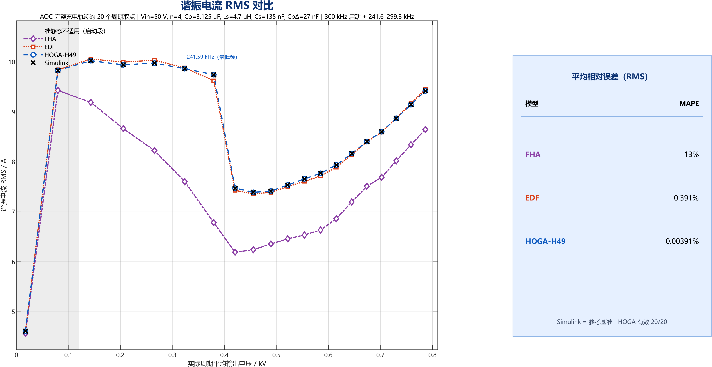
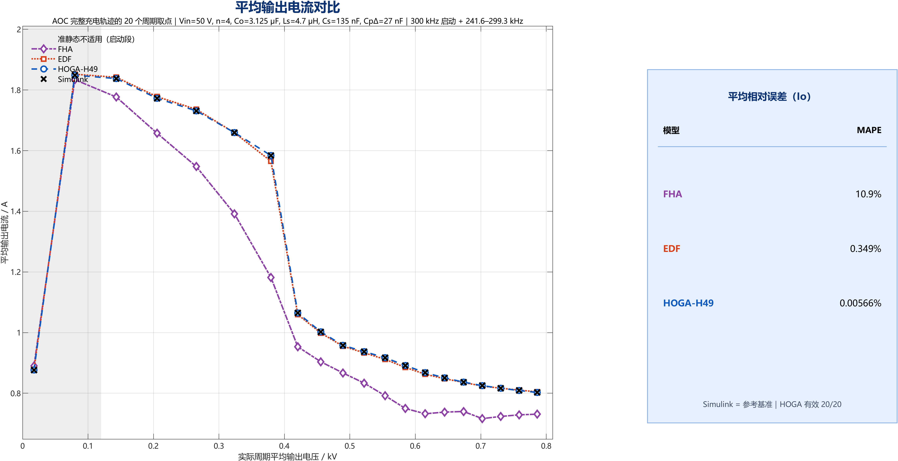
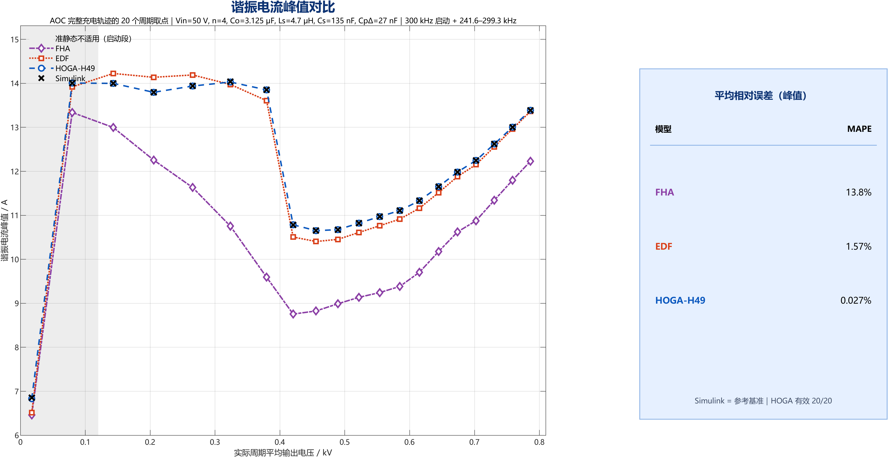
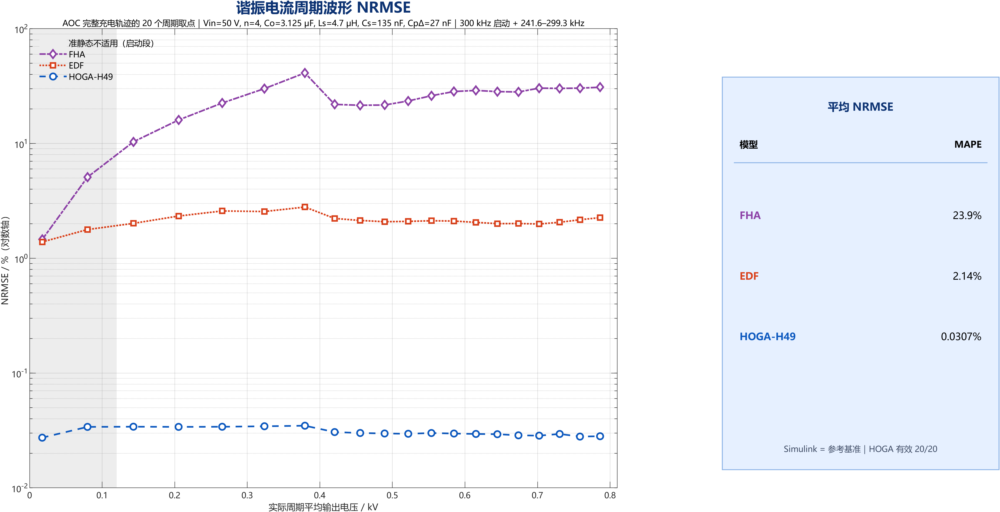

# 06 充电全过程：AOC 20 点精度验证

> 数据：`data/aoc/`；完整报告：`reports/aoc/AOC_20point_accuracy_report.md`；摘要：`reports/aoc/AOC_输出特性工作总结.md`。
> 这一组结果回答的是：沿一条真实的 0→800 V AOC 变频充电轨迹，HOGA-H49、EDF、FHA 在**每个工作点的输出特性**上分别有多准。

## 6.1 充电轨迹

- 主电路同 `docs/01`：50 V、Δ/Y 三相 LCC、共用六管桥、Co 等效 3.125 μF。
- AOC 频率表：59 节点，主段 **241.5905–299.2573 kHz**，0–20 V 用 300 kHz 启动。
- 真实充电：`0 → 800 V` 用时 **2.153487 ms**（旧 280–299 kHz 表为 2.596206 ms）。
- 输出点：在 `[0, t800]` 上按时间 20 等分取中点，得到 17.4–786.2 V、241.6–300 kHz 的 20 个工况（P01 为 300 kHz 启动点，其余 19 点为 241.6–299.3 kHz）。
- 每个点把 Co 替换为两个 `Vo/2` 理想电压源，固定该点 `fs`，跑 24 周期至稳态；末周期 8192 点作为参考。
- 相邻周期波形相对差 **1.1e-5–4.7e-5**，说明冻结参考已基本周期收敛。

> 注意：AOC 是**研究情景**的频率表；14 A 峰值是情景上限，不是硬件许可。参考是理想开关 Simulink，不是实验。

## 6.2 20 点汇总

| 指标 MAPE | HOGA-H49 | EDF | FHA |
|---|---:|---:|---:|
| 三相平均 RMS | **0.00391%** | 0.391% | 13.027% |
| 平均输出电流 `Io` | **0.00566%** | 0.349% | 10.921% |
| 三相峰值 | **0.0270%** | 1.573% | 13.784% |
| 波形 NRMSE 均值 | **0.0307%** | 2.138% | 23.851% |

MAE（绝对量）：

| 指标 | HOGA-H49 | EDF | FHA |
|---|---:|---:|---:|
| RMS MAE | **0.339 mA** | 33.850 mA | 1.130 A |
| `Io` MAE | **0.0625 mA** | 4.023 mA | 0.1213 A |
| 峰值 MAE | **2.487 mA** | 176.677 mA | 1.680 A |
| 波形 NRMSE 最大 | **0.0348%** | 2.796% | 41.191% |

20/20 全部有效（HOGA-H49 通过十项验收）。

## 6.3 逐点观察

| 模型 | `Io` 最大相对误差 | 出现点 | RMS 最大相对误差 | 峰值最大相对误差 | NRMSE 最大 |
|---|---:|---|---:|---:|---:|
| HOGA-H49 | **0.01638%** | 673.7 V / 290.4 kHz | 0.00679% | 0.3299% | 0.0348% |
| EDF | 1.171% | 379.4 V / 241.59 kHz | 1.256% | 4.952% | 2.796% |
| FHA | 25.37% | 379.4 V / 241.59 kHz | 30.389% | 30.747% | 41.191% |

关键点：

- **379.4 V / 241.59 kHz** 是 EDF 与 FHA 的最差点：EDF `Io` 误差 1.171%、RMS 1.256%；FHA `Io` 误差 25.37%、RMS 30.39%。这是 AOC 表的最低频点，也是“低频大电流 + 基波假设”最容易失效的地方。
- HOGA 的最差 `Io` 点在 673.7 V（0.01638%），不在最低频；全程几乎平坦。
- HOGA 的最大峰值误差 0.3299% 出现在 17.4 V 启动点，属于低压大电流/准静态边界，不是高压段。
- EDF 在多数点 0.03–0.7%，但在最低频点跳到 1.17%；说明“基波 + 描述函数”在低频大电流下仍有可测的截断/闭合误差。
- FHA 的低压大电流段误差最大（25% 量级），中高压段也常有 8–17% 的 RMS/峰值误差；不能用“平均输出接近”掩盖波形/应力误差。

## 6.4 准静态边界

真实充电周期与冻结波形对比：

| `Vo`/V | RMS 相对差 | `Io` 相对差 | 准静态标记 |
|---:|---:|---:|---|
| 17.4 | 42.17% | 43.85% | 否 |
| 79.8 | 4.735% | 4.880% | 否 |
| 143.1 | 0.593% | 0.670% | 边缘 |
| 205.4 | 0.662% | 0.739% | 边缘 |
| 265.4 | 0.444% | 0.504% | 是 |
| 323.6 | 0.323% | 0.396% | 是 |
| 379.4 | 0.151% | 0.199% | 是 |
| ≥420 | ≤0.113% | ≤0.292% | 是 |

因此：

- 17.4 V 与 79.8 V 两点**不满足**准静态假设，应作为“瞬态–冻结对照”，不应与其余点一起用于模型排名。
- 143 V、205 V 是边缘点；如果严格按 1% 判据，也应标注。
- 420 V 以上，冻结参考与真实充电周期的差异 ≤0.3%，可以用冻结模型近似。

> 这也解释了为什么 HOGA 在 17.4 V 的峰值误差 0.3299% 仍然存在：该点本身不是准静态，冻结参考与真实波形差 42%，不能把 0.33% 当成“模型在启动瞬态的峰值精度”。

## 6.5 参考自身的数值平台

- 参考用 1e-6 Ω 正则；fine 用 1e-7 Ω、64 周期。
- 3 点加密复核使 `Io` 变化约 15 μA、RMS 变化 0.1–0.26 mA。
- HOGA 的 RMS 误差（0.1–0.5 mA）已接近该平台，因此 **0.004% 应理解为“与参考在数值平台内一致”，不是物理精度**。
- 冻结参考用独立事件 ODE 只提供初始状态，不提供任何结果值；参考本身不是实验真值。

## 6.6 这组结果能支持什么、不能支持什么

能支持：

1. 在本 AOC 轨迹、本参数、本理想开关参考下，HOGA-H49 的 `Io`、RMS、峰值、波形精度显著优于本工程的 EDF/FHA。
2. HOGA 的误差沿 0→800 V 轨迹基本平坦，没有在某个电压段突然失效。
3. EDF/FHA 的失效点可以定位到具体工况（最低频 379.4 V、低压大电流段），不是“全程都不准”或“全程都准”。
4. 准静态边界可以用“真实周期 vs 冻结波形”的差异定量标出。

不能支持：

1. 不能声称 20 点都是准静态；17.4 V、79.8 V 不满足。
2. 不能声称 H49 的阶数已经收敛；本轮没有 H49 以上的阶数扫描。
3. 不能声称“HOGA 在全参数域都最准”；只有 20 个 AOC 采样点。
4. 不能把 0.004% 当成物理精度；参考平台差约 15 μA / 0.2 mA。
5. 不能把 AOC 频率表当成硬件最优或可实现策略；14 A、频率窗口是研究情景。
6. 不能声称完成了损耗/温升/闭环/实验验证。

## 6.7 评审时最值得追问的 7 个问题

以下问题来自原项目的 GPT 评审请求，保留下来供后续复核：

1. **指标口径**：`Io` 在个别点可能接近 0，MAPE 会被小分母放大；是否应以 MAE 为主、MAPE 为辅？是否按充电时间/电荷量加权？
2. **误差上界**：参考自身有 15 μA / 0.2 mA 平台差，如何把“模型误差”和“参考误差”分开？是否应用 fine 正则重做参考，或给出区间估计？
3. **EDF 机理**：241.59 kHz 的 1.2% 是基波假设，还是描述函数在低频大电流下的截断？缺少可判定的分解实验。
4. **FHA 失效机理**：低压大电流 4–30%、中高压 8–17%，是整流端口等效、Cp 非导通区间，还是谐波？
5. **工程用法**：AOC 是 59 点阶梯表，是否需要连续 `Io(Vo,fs)` 拟合？拟合误差如何进入充电时间/应力预算？
6. **准静态边界**：17.4 V 与 79.8 V 是否应改为“瞬态–冻结对照”，不计入精度统计？
7. **统计口径**：10 点 vs 20 点、等时间 vs 等电压、是否按充电时间加权？

## 6.8 来源

- `reports/aoc/AOC_20point_accuracy_report.md`
- `reports/aoc/AOC_输出特性工作总结.md`
- `data/aoc/accuracy_10points.csv`
- `data/aoc/accuracy_summary.csv`
- `data/aoc/selected_points.csv`
- `data/aoc/transient_vs_frozen.csv`
- `data/aoc/aoc_smooth254_59_nodes.csv`
